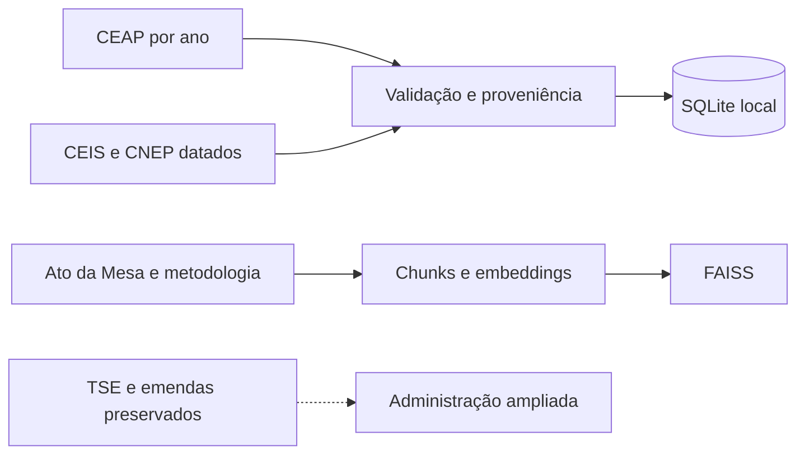
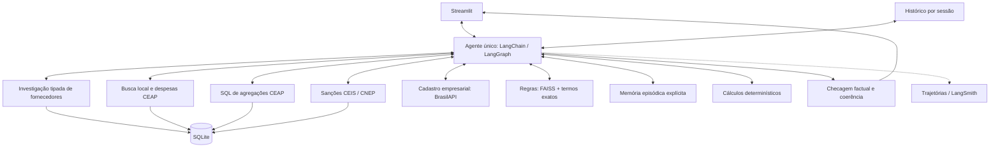

# ApuraMandato — arquitetura do núcleo

## Preparação e armazenamento

O setup padrão prepara somente CEAP, CEIS, CNEP e FAISS. TSE, emendas, favorecidos e identidades permanecem como extensão, acessível por `setup_project.py --ampliado`. A interface não oferece essas fontes. Os dados já existentes foram preservados.

A CEAP é ligada ao parlamentar por `id_deputado`. Sanções são identificadas por cadastro e código oficial, com CNPJ completo validado para consultas empresariais. Cada carga preserva arquivo, hash, data e lote. Sanções também preservam a linha original, as datas, categoria, órgão, abrangência, fundamento, processo, multa e observações.

## Agente e ferramentas

A busca de deputados usa o histórico local, inclusive em anos recentes. BrasilAPI é a ferramenta externa usada para evidenciar function calling real. Não há chamadas à API de gastos nem à API CGU no fluxo principal. Dados indisponíveis não são substituídos por outra fonte.

`consultar_ceap` só lê a tabela CEAP, valida anos e limita linhas. A extensão `consultar_dados` permanece fora do toolkit principal. Seu autorizador permite as dependências internas das views, inclusive leituras de metadados que o otimizador SQLite emite sem coluna, mas rejeita tabelas citadas diretamente. A cobertura da extensão é avaliada por fonte, sem impor automaticamente o ano eleitoral a uma despesa parlamentar de outro ano.

## Continuidade, verificação e recuperação

A memória curta usa checkpointer por sessão e janela de tokens. A memória episódica persiste resumos solicitados pelo usuário; normas compõem a memória semântica e prompts/ferramentas a memória procedural.

A troca curta de ano conserva identidade e categoria. O detalhamento anual conserva o ID, filtro e intervalo do ranking anterior. Fornecedores são consultados no mesmo recorte; várias empresas exigem escolha antes do cadastro ou sanções.

A auditoria reexecuta consultas e compara valores com a mesma identidade e período. IDs técnicos não são exigidos no texto para reconhecer a pessoa; anos e rótulos apresentados continuam relevantes. A soma anual é uma referência separada, explicitamente rotulada. Isso checa consistência, não independência da fonte nem legalidade da despesa.

O RAG combina candidatos semânticos de FAISS com termos exatos dos documentos, ponderados pela frequência. Brasília é normalizada para Distrito Federal na busca. A mudança corrige a perda de uma exceção curta sobre hospedagem identificada no teste offline. Os testes preservam o documento-fonte e não atribuem aos embeddings falsos qualidade semântica de produção.

## Avaliação e limites

`devbox run validate` executa nove passos do núcleo sobre o banco selecionado e grava respostas, trajetórias, referências e verificações. A consulta de sanções sem carga é marcada como pendência. `validate-online` executa o mesmo fluxo com modelo real e falha explicitamente se faltar rede/chave. O conjunto de avaliação LangSmith foi reduzido ao núcleo; casos ampliados permanecem separados.

O núcleo mantém chain estruturada, composição LCEL/imperativa, agente, API, SQL, RAG, memória, verificação e Streamlit. A comparação de orquestradores e ferramentas de memória, o diagnóstico de recuperação e as equivalências de APIs antigas são documentados nos notebooks e relatório.

## Ensaio de investigação e controles

`investigar_fornecedores` concentra seis ações com argumentos tipados: ranking, evolução, categorias, concentração, outros deputados e participação. `contexto_investigacao` preserva identidade, intervalo, categoria e seleção; um esclarecimento de período conserva o pedido anterior sem confiar em valores da prosa. A interface mantém um único agente, com trechos determinísticos para os cálculos recorrentes e o modelo para outras decisões e interpretações.

O roteiro completo compara o resultado com SQL separado no mesmo banco. Testes controlados usam valores conhecidos, empresas homônimas, CNPJs de matriz/filial, estornos, pessoa física no denominador, ausência de fonte e ambiguidades. A auditoria reexecuta ações estruturadas e compara o texto com a apresentação de referência; não simula NLI por modelo. Chamadas com respostas livres continuam usando a verificação geral. A execução online é registrada separadamente e não faz fallback silencioso.
